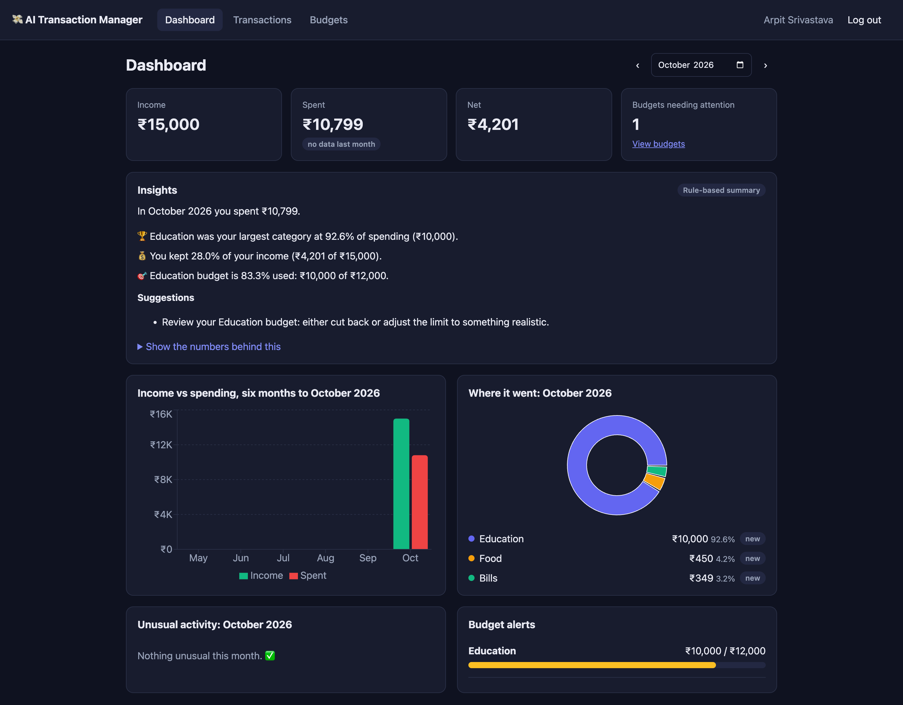
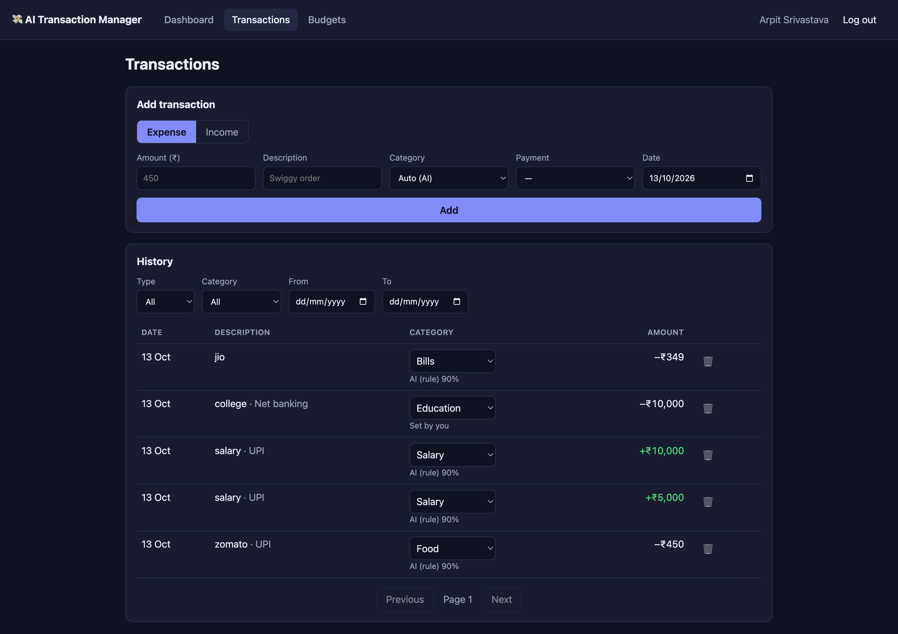
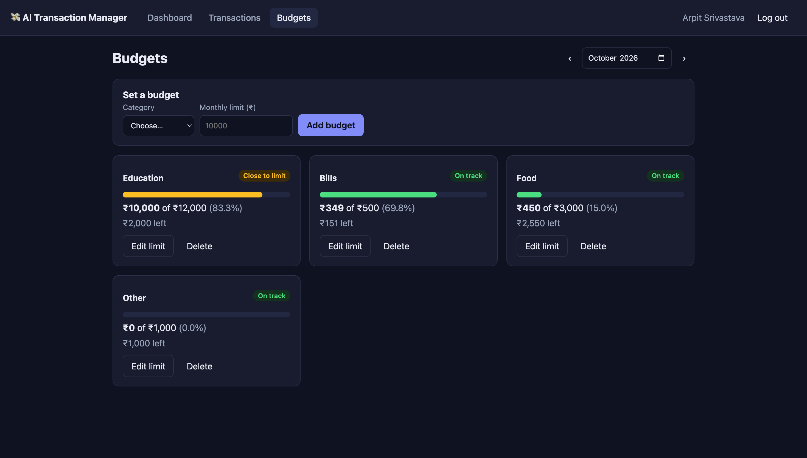

# 🪙 AI Transaction Manager

A full-stack personal finance app with AI-powered categorization, spending insights, anomaly detection, and budget tracking.

**Stack:** FastAPI · PostgreSQL · React · TypeScript · Vite · Expo (React Native)

---

## Screenshots

### Dashboard


### Transactions


### Budgets


---

## Features

- **AI Categorization** — Transactions are auto-categorized using your past labels → keyword rules → optional LLM (Claude). Confidence score shown on every transaction.
- **Spending Insights** — Monthly summary with findings and actionable suggestions, generated from SQL facts with an optional LLM rewrite.
- **Anomaly Detection** — Flags expenses far above your typical spend for a category and duplicate charges within a day.
- **Budget Tracking** — Per-category monthly limits with real-time status (`on track` / `close to limit` / `exceeded`), projected month-end spend, and alerts.
- **Web Dashboard** — React + Vite app with charts, AI insights, transaction history, and budget management.
- **Mobile App** — Expo (React Native) app with quick-add, receipt scanning, budgets, and insights.

---

## Quick Start

### 1. Backend

```bash
# Start PostgreSQL
brew services start postgresql@17   # or: docker compose up -d

cd backend
cp .env.example .env                # fill in SECRET_KEY and optionally ANTHROPIC_API_KEY
python -m venv .venv && source .venv/bin/activate
pip install -r requirements.txt
uvicorn app.main:app --reload       # http://localhost:8000
```

Visit [http://localhost:8000/docs](http://localhost:8000/docs) → `POST /auth/register` → **Authorize** → explore endpoints.

### 2. Web Dashboard

```bash
cd web
cp .env.example .env
npm install
npm run dev                         # http://localhost:5173
```

### 3. Mobile App

```bash
cd mobile
cp .env.example .env
npm install
npx expo start
```

For an Android APK see [`mobile/BUILD_APK.md`](mobile/BUILD_APK.md).

---

## Environment Variables

Copy `backend/.env.example` to `backend/.env` and fill in:

| Variable | Description |
|---|---|
| `DATABASE_URL` | PostgreSQL connection string |
| `SECRET_KEY` | Run `openssl rand -hex 32` to generate |
| `ACCESS_TOKEN_EXPIRE_MINUTES` | JWT lifetime (default: 60) |
| `ANTHROPIC_API_KEY` | Optional — enables LLM insights & receipt scanning |
| `ANTHROPIC_MODEL` | Claude model to use (default: `claude-haiku-4-5-20251001`) |
| `AUTO_CATEGORIZE_THRESHOLD` | Min confidence to auto-apply AI category (default: 0.75) |
| `CORS_ORIGINS` | JSON list of allowed browser origins |

> Without `ANTHROPIC_API_KEY` the app still works fully — categorization uses history + keyword rules, and insights use template-based summaries.

---

## How AI Categorization Works

`POST /transactions` without a `category_id` triggers auto-categorization when confidence ≥ `AUTO_CATEGORIZE_THRESHOLD`.  
`POST /ai/categorize` returns a suggestion without saving (used for live previews and receipt scanning).

**Resolution order:**
1. Your own past labels for similar descriptions
2. Keyword rules (e.g. "zomato" → Food, "salary" → Salary)
3. LLM fallback via Claude *(only if `ANTHROPIC_API_KEY` is set)*

---

## API Highlights

| Endpoint | Description |
|---|---|
| `POST /auth/register` | Create account |
| `POST /auth/login` | Get JWT token |
| `GET/POST /transactions` | List / create transactions |
| `GET /categories` | List categories |
| `POST /ai/categorize` | Preview AI category suggestion |
| `POST /ai/receipt` | Scan a receipt image (needs API key) |
| `GET /ai/insights?month=YYYY-MM` | Monthly AI spending summary |
| `GET /ai/anomalies?days=30` | Unusual activity and duplicate charges |
| `GET /analytics/monthly?months=6` | Income vs spend bar chart data |
| `GET /analytics/categories?month=YYYY-MM` | Category breakdown |
| `GET/POST /budgets` | Manage monthly category budgets |
| `GET /budgets/alerts` | Budgets at warning or exceeded status |

---

## Tests

Full testing guide (Swagger walkthrough, Postman collection, pytest): [docs/TESTING.md](docs/TESTING.md)

```bash
cd backend && python -m pytest
```

Tests use in-memory SQLite by default. Set `TEST_DATABASE_URL` to run against PostgreSQL.

---

## Project Structure

```
ai-transaction-manager/
├── backend/               # FastAPI + SQLAlchemy + PostgreSQL
│   ├── app/
│   │   ├── models/        # SQLAlchemy ORM models
│   │   ├── routes/        # API route handlers
│   │   ├── schemas/       # Pydantic request/response schemas
│   │   └── services/      # AI, analytics, budget logic
│   └── tests/             # pytest test suite
├── web/                   # React + TypeScript + Vite dashboard
│   └── src/
│       ├── pages/         # Dashboard, Transactions, Budgets, Login
│       ├── components/    # Layout, TransactionForm, UI primitives
│       └── api/           # API client and typed hooks
├── mobile/                # Expo (React Native) app
│   └── src/
│       ├── app/           # File-based routing (Expo Router)
│       ├── components/    # Shared UI components
│       └── lib/           # Hooks, formatting, storage
└── docs/                  # Testing guide, Postman collection, screenshots
```

---

## Roadmap

- [x] Project setup
- [x] Database (SQLAlchemy 2.0)
- [x] Auth (register / login / JWT)
- [x] Transactions CRUD + filters
- [x] Categories
- [x] AI categorization (history → keyword rules → optional LLM)
- [x] Analytics (monthly + category breakdown with month-over-month)
- [x] AI insights (SQL facts → findings → optional LLM wording)
- [x] Anomaly detection (outliers + duplicate charges)
- [x] Budgets (monthly limits, status, alerts, projections)
- [x] Web dashboard (React + Vite)
- [x] Mobile app (Expo + receipt scanning)
